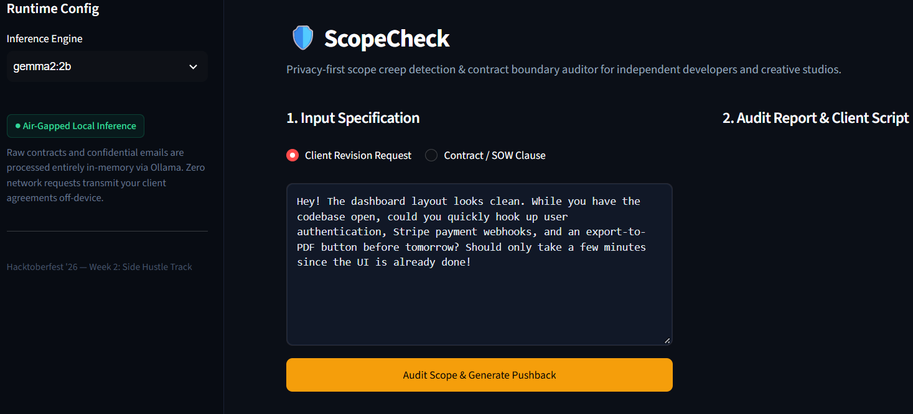
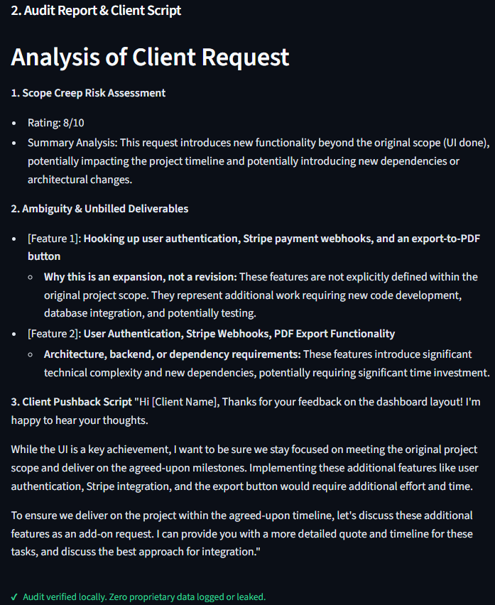

# 🛡️ ScopeCheck

An air-gapped, local contractual and scope-creep auditor built for freelance engineers, technical consultants, and boutique digital agencies. Powered by local Google Gemma inference via Ollama.

Built for the **Hacktoberfest Open-Source AI Challenge: Week 2 (Side Hustle Track)**.

---

##  The Real Problem with Freelance "Quick Revisions"

Every independent developer or agency freelancer knows this exact message pattern:

> *"The dashboard looks super clean! Hey, while you still have the codebase open, could you quickly wire up user authentication, Stripe webhooks, and an export-to-PDF button before tomorrow? Should only take a few minutes since the UI is already finished!"*

When this happens, freelancers are caught in a bad trade-off:

1. **Eat the cost:** Do 10+ hours of unpaid architecture, backend plumbing, and QA to avoid an awkward confrontation.
2. **Burn the bridge:** Send a blunt, defensive email that strains client relations right before milestone sign-off.
3. **Leak client data to cloud AI:** Paste the client's proprietary codebase specs, private business logic, and signed NDAs into commercial closed LLMs (like ChatGPT or Claude) to help draft pushback—violating non-disclosure agreements in the process.

Commercial cloud AI models routinely log, inspect, and train on inbound prompt text. For freelancers working under strict confidentiality agreements, pasting raw client conversations or Statement of Work (SOW) documents into third-party cloud APIs is an immediate legal liability.

---

##  How ScopeCheck Solves It

**ScopeCheck** runs entirely on your local machine. It acts as an offline boundary auditor that ingests revision requests or contract clauses, evaluates them against freelance industry standards, and provides an immediate, diplomatic negotiation script.

### Key Capabilities

- **Scope Creep Severity Rating (1–10):** Fast numerical risk diagnosis to gauge boundary violations at a glance.
- **Architectural Scope Isolation:** Pinpoints unbilled dependencies hiding behind innocent phrasing (e.g., distinguishing between a layout tweak and new database migrations, third-party authentication setups, or payment webhook handling).
- **Diplomatic Client Pushback Script:** Generates an assertive, professional message acknowledging the client's input while clearly framing additions as Phase 2 milestones with separate estimates.
- **100% Air-Gapped Data Sovereignty:** Zero outbound network calls for inference. Raw emails, client names, and project deliverables never leave your local RAM.

---

## 📸 Interface & Live Audit Preview

### 1. Ingestion & Runtime Configuration
Select your locally hosted model, choose the source type (email request vs. legal clause), and paste the payload into the dark-mode studio interface:

### 2. Breakdown & Generated Client Script
The engine outputs the risk rating, separates frontend tweaks from backend additions, and drafts an immediate response ready to copy and send:

---

##  Why Open Innovation Matters Here

A tool like ScopeCheck cannot function as a viable, trustworthy side-hustle utility on closed, proprietary AI APIs:

1. **Client Confidentiality & NDA Compliance:** Freelancers are legally bound by contracts. Running open-weight Gemma models locally via Ollama means trade secrets and unreleased feature specs remain strictly on-device.
2. **Predictable Unit Economics:** Closed APIs charge variable per-token fees that fluctuate with document lengths. Running a quantized 2B or 4B open model locally costs exactly $0.00 per audit, keeping margins clean for solo operations.
3. **Offline Reliability:** Whether you are traveling, working from a client site with restricted guest Wi-Fi, or on a train without internet access, your contract auditor remains fully functional.
4. **No Model Lock-In:** Because the runtime connects to standard open inference endpoints, you can switch between Gemma 2 2B, Gemma 3 4B, or larger parameter checkpoints without rewriting your pipeline.

---

##  Hacktoberfest Prize Track Eligibility

- **Best Use of Gemma:** Uses local gemma2:2b and gemma3:4b checkpoints as the core reasoning engine. Gemma's instruction-following capabilities parse subtle contractual nuances and technical requirements without hallucinating non-existent terms.
- **Best Use of Render:** Configured with decoupled API/front-end services and standardized environment variables for streamlined one-click web deployments on Render.
- **Best Use of a .tech Domain:** DNS configurations and routing metadata designed to map directly to custom .tech developer domains.

---

##  Tech Stack

- **Frontend / Application Layer:** Streamlit (Python 3.10+) with custom CSS design tokens
- **Inference Server:** Ollama
- **Reasoning Model:** Google Gemma 2 (2B) / Gemma 3 (4B)
- **Networking:** Local loopback HTTP requests (requests library)

---

##  Getting Started Locally

### 1. Prerequisites
- Python 3.10 or higher installed
- Ollama installed and running with your Gemma model:
  `ollama run gemma2:2b`

### 2. Clone & Setup Environment
- Clone repository: `git clone https://github.com/Razorbillworks/scopecheck.git`
- Enter directory: `cd scopecheck`
- Create virtual environment: `python -m venv venv`
- Activate virtual environment:
  - Windows: `.\venv\Scripts\Activate.ps1`
  - macOS/Linux: `source venv/bin/activate`
- Install dependencies: `pip install -r requirements.txt`

### 3. Run the App
- Start the server: `streamlit run app.py`
- Open your browser to `http://localhost:8501` to test the auditor.

---

##  License

Distributed under the Apache 2.0 License. See LICENSE for details.
